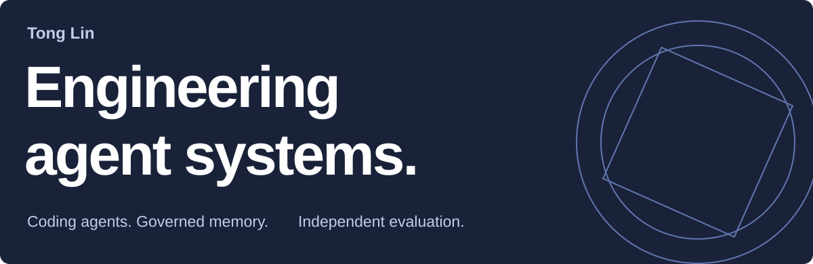
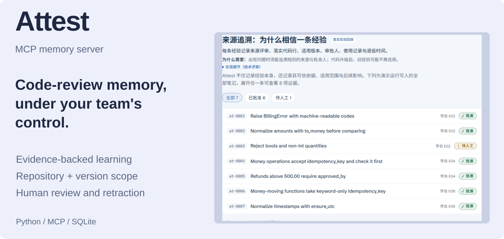
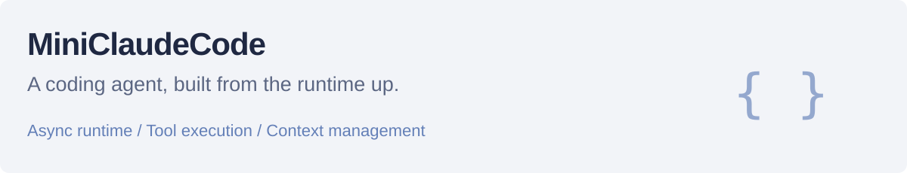
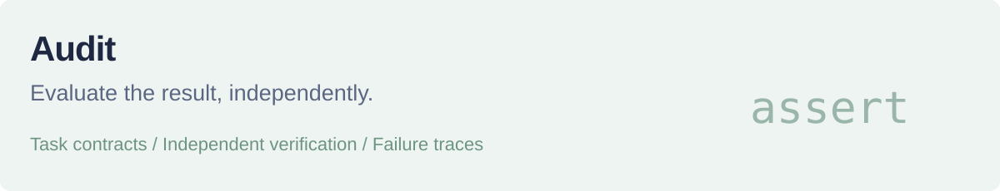

<picture>
  <source media="(max-width: 600px) and (prefers-color-scheme: dark)" srcset="assets/portfolio/cover-mobile-dark.svg">
  <source media="(max-width: 600px)" srcset="assets/portfolio/cover-mobile-light.svg">
  <source media="(prefers-color-scheme: dark)" srcset="assets/portfolio/cover-dark.svg">
  
</picture>

I build coding agents and the systems that help teams remember, inspect, and verify their work.

## Selected work

<a href="https://github.com/tonglynn/attest-agent-memory">
  <picture>
    <source media="(max-width: 600px) and (prefers-color-scheme: dark)" srcset="assets/portfolio/attest-mobile-dark.svg">
    <source media="(max-width: 600px)" srcset="assets/portfolio/attest-mobile-light.svg">
    <source media="(prefers-color-scheme: dark)" srcset="assets/portfolio/attest-dark.svg">
    
  </picture>
</a>

 

[Interactive demo](https://tonglynn.github.io/attest-agent-memory/) · [Source & setup](https://github.com/tonglynn/attest-agent-memory) · [Results & limitations](https://github.com/tonglynn/attest-agent-memory/blob/main/RESULTS.md) · [中文](https://github.com/tonglynn/attest-agent-memory/blob/main/README.zh-CN.md)

Open evidence: <a href="https://github.com/tonglynn/attest-agent-memory/actions/workflows/ci.yml">177 passing tests</a> · <a href="https://github.com/tonglynn/attest-agent-memory/tree/main/runs/main">450 main-study runs</a> · <a href="https://github.com/tonglynn/attest-agent-memory/blob/main/PREREGISTRATION.md">Preregistered protocol</a>. One model, author-designed synthetic benchmark.

<a href="https://github.com/tonglynn/MiniClaudeCode">
  <picture>
    <source media="(max-width: 600px) and (prefers-color-scheme: dark)" srcset="assets/portfolio/runtime-mobile-dark.svg">
    <source media="(max-width: 600px)" srcset="assets/portfolio/runtime-mobile-light.svg">
    <source media="(prefers-color-scheme: dark)" srcset="assets/portfolio/runtime-dark.svg">
    
  </picture>
</a>

[Runtime design](https://github.com/tonglynn/MiniClaudeCode/blob/main/docs/design.md) · [Release verification](https://github.com/tonglynn/MiniClaudeCode/blob/main/VERIFICATION.md) · [Live-run evidence](https://github.com/tonglynn/MiniClaudeCode/blob/main/evidence/live-smoke.json)

<a href="https://github.com/tonglynn/Audit">
  <picture>
    <source media="(max-width: 600px) and (prefers-color-scheme: dark)" srcset="assets/portfolio/audit-mobile-dark.svg">
    <source media="(max-width: 600px)" srcset="assets/portfolio/audit-mobile-light.svg">
    <source media="(prefers-color-scheme: dark)" srcset="assets/portfolio/audit-dark.svg">
    
  </picture>
</a>

[Contracts & telemetry](https://github.com/tonglynn/Audit/blob/main/docs/formats.md) · [Release verification](https://github.com/tonglynn/Audit/blob/main/VERIFICATION.md) · [Integration evidence](https://github.com/tonglynn/Audit/blob/main/evidence/live-smoke.json)

Verification notes & more projects

- **MiniClaudeCode:** 122 release tests, 26 offline contract checks, Windows/Ubuntu CI, and one live model task.
- **Audit:** 53 release tests, 26 offline contract checks, Windows/Ubuntu CI, and one real MiniClaudeCode integration run.
- Offline checks validate reconstructed fixtures and the evaluator; they are not model success rates.
- [tiny-agent-harness](https://github.com/tonglynn/tiny-agent-harness) — Hidden-test evaluation and ablations.
- [Tabular classification skill](https://github.com/tonglynn/in6227-tabular-classification-skill) — Reusable data-mining and reporting workflows.

