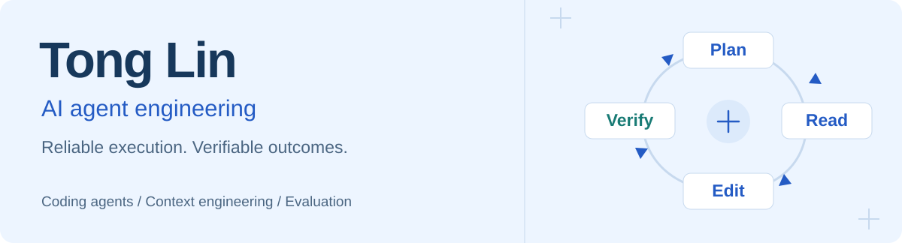
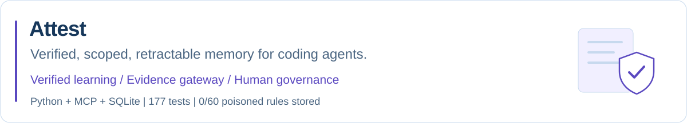
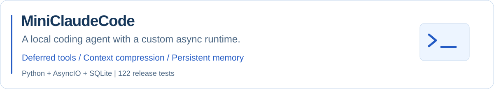
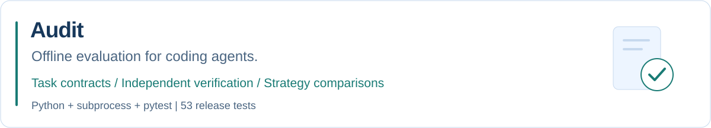

<picture>
  <source media="(max-width: 600px) and (prefers-color-scheme: dark)" srcset="assets/header-mobile-dark.svg">
  <source media="(max-width: 600px)" srcset="assets/header-mobile-light.svg">
  <source media="(prefers-color-scheme: dark)" srcset="assets/header-dark.svg">
  
</picture>

  <a href="#selected-work">Projects</a> &nbsp; / &nbsp;
  <a href="#engineering-focus">Focus</a> &nbsp; / &nbsp;
  <a href="#more-code">More</a>

I build coding agents and the systems that make their work measurable: tool runtimes, context management, permission controls, and independent evaluation.

  <code>Python</code> &nbsp; <code>AsyncIO</code> &nbsp; <code>SQLite</code> &nbsp;
  <code>pytest</code> &nbsp; <code>Git</code> &nbsp; <code>LLM APIs</code>

## Selected work

<a href="https://github.com/tonglynn/attest-agent-memory">
  <picture>
    <source media="(max-width: 600px) and (prefers-color-scheme: dark)" srcset="assets/attest-mobile-dark.svg">
    <source media="(max-width: 600px)" srcset="assets/attest-mobile-light.svg">
    <source media="(prefers-color-scheme: dark)" srcset="assets/attest-dark.svg">
    
  </picture>
</a>

Team memory for MCP coding agents that learns from code review only what a verified change actually applied. A deterministic evidence gateway approves, rejects, or holds each note for a person; notes are scoped to repository and version, and only people can approve or retract them. Held-out first-attempt pass rate **33% → 70%** in a preregistered experiment; test-passing poisoned advice stored as a rule **0/60** times.

[Source & setup](https://github.com/tonglynn/attest-agent-memory) · [Live demo](https://tonglynn.github.io/attest-agent-memory/) · [Results](https://github.com/tonglynn/attest-agent-memory/blob/main/RESULTS.md) · [中文](https://github.com/tonglynn/attest-agent-memory/blob/main/README.zh-CN.md)

 

<a href="https://github.com/tonglynn/MiniClaudeCode">
  <picture>
    <source media="(max-width: 600px) and (prefers-color-scheme: dark)" srcset="assets/miniclaudecode-mobile-dark.svg">
    <source media="(max-width: 600px)" srcset="assets/miniclaudecode-mobile-light.svg">
    <source media="(prefers-color-scheme: dark)" srcset="assets/miniclaudecode-dark.svg">
    
  </picture>
</a>

An asynchronous agent runtime with **13 tools**, OpenAI-compatible and Anthropic-compatible streaming, five permission modes, and resumable sessions. Four-stage compression and semantic memory recall support longer tasks.

[Source & setup](https://github.com/tonglynn/MiniClaudeCode) · [Runtime design](https://github.com/tonglynn/MiniClaudeCode/blob/main/docs/design.md) · [Verification](https://github.com/tonglynn/MiniClaudeCode/blob/main/VERIFICATION.md) · [中文](https://github.com/tonglynn/MiniClaudeCode/blob/main/docs/README.zh-CN.md)

 

<a href="https://github.com/tonglynn/Audit">
  <picture>
    <source media="(max-width: 600px) and (prefers-color-scheme: dark)" srcset="assets/audit-mobile-dark.svg">
    <source media="(max-width: 600px)" srcset="assets/audit-mobile-light.svg">
    <source media="(prefers-color-scheme: dark)" srcset="assets/audit-dark.svg">
    
  </picture>
</a>

An independent evaluation CLI built around **task contracts → evidence collection → metric aggregation**. It runs external agents in fresh fixtures, checks final implementations, records failures, and compares strategies across repeated attempts.

[Source & setup](https://github.com/tonglynn/Audit) · [Contracts & telemetry](https://github.com/tonglynn/Audit/blob/main/docs/formats.md) · [Verification](https://github.com/tonglynn/Audit/blob/main/VERIFICATION.md) · [中文](https://github.com/tonglynn/Audit/blob/main/docs/README.zh-CN.md)

Release evidence for MiniClaudeCode and Audit: both passed 26 reconstructed contract/verifier checks and one live coding task each. Offline contract checks are separate from model completion benchmarks; agent-reported telemetry is labeled in the evaluation reports.

## Engineering focus

- **Agent execution:** tool calling, asynchronous scheduling, streaming, and recoverable sessions.
- **Context engineering:** staged compression, persistent memory, and project instructions.
- **Agent memory:** verified learning, repository and version scoping, poisoning defence, and human governance.
- **Evaluation:** independent outcomes, failure diagnosis, reproducible contracts, and ablation studies.

## More code

- [tiny-agent-harness](https://github.com/tonglynn/tiny-agent-harness) — A coding-agent harness with hidden-test evaluation and four-way ablations.
- [Tabular classification skill](https://github.com/tonglynn/in6227-tabular-classification-skill) — A reusable data-mining workflow with automated report generation.

Build the agent. Inspect the trace. Verify the result.

